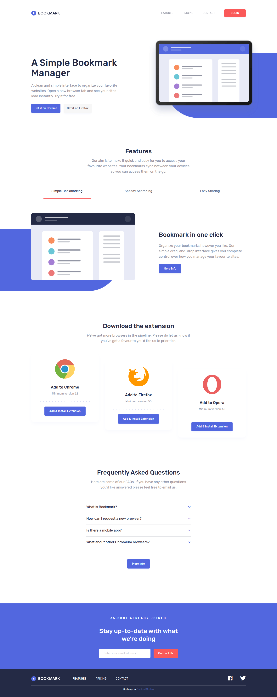

# Frontend Mentor - Bookmark landing page solution

This is a solution to the [Bookmark landing page challenge on Frontend Mentor](https://www.frontendmentor.io/challenges/bookmark-landing-page-5d0b588a9edda32581d29158).

## Overview

This is a landing page for a bookmark manager that supports different browsers like Chrome, Firefox and Opera. On this page users can:

- View the optimal layout for the site depending on their device's screen size
- See hover states for all interactive elements on the page
- Receive an error message when the newsletter form is submitted if:
  - The input field is empty
  - The email address is not formatted correctly

### Screenshot

### Links

<!-- Add live link -->

### Built with

- Semantic HTML5 markup
- CSS custom properties
- Flexbox
- CSS Grid
- Vanilla JavaScript (DOM manipulation)
- BEM methodology

## Acknowledgments

- Challenge by [Frontend Mentor](https://www.frontendmentor.io).
